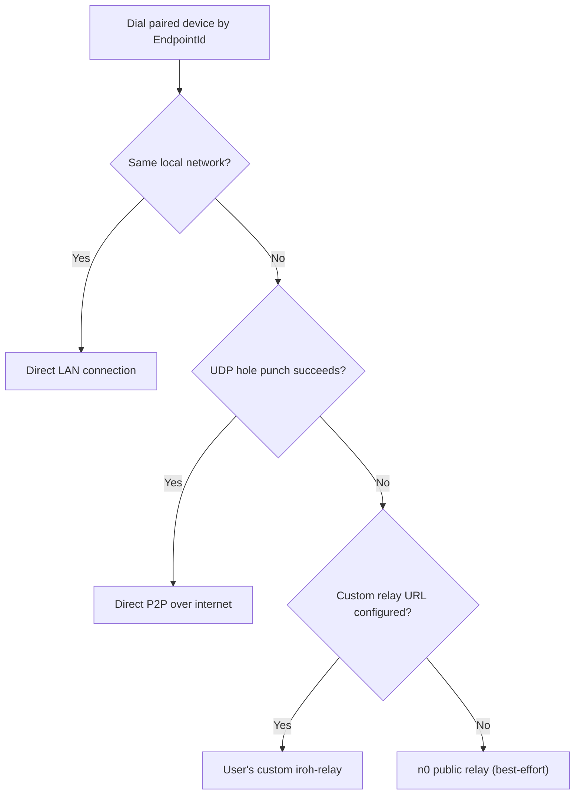

# Feature Plan: Bidirectional Remote Server Control (Desktop ↔ Android)

> **Status:** Proposed / Planning  
> **Scope:** Desktop & Android (`src-tauri`, `src/`, `crates/remote`)  
> **Cost Constraint:** \$0 infrastructure cost (no Ingot-hosted servers, no user accounts, no subscriptions)

---

## 1. Overview & Goals

Enable any Ingot installation (Desktop or Android) to securely monitor and control Minecraft servers hosted on another paired Ingot installation—over both local Wi-Fi (LAN) and the open internet (including mobile data / CGNAT).

The architecture is **symmetric**:
- **Phone hosts, Desktop controls:** A server runs on Android inside `ServerHostService`; the Desktop app monitors metrics, views the live console, and sends commands.
- **Desktop hosts, Phone controls:** A server runs on Desktop (including in the system tray); the Android app monitors and controls it on the go.
- **Both at once:** Any paired device can act as both a **Remote Host** and a **Remote Client** simultaneously.

---

## 2. Core Constraints & Design Principles

1. **Zero Hosting Cost:**
   - Ingot operates **no central servers, databases, or relays**.
   - Device identity and trust are stored locally on each device.
   - Connectivity uses **P2P QUIC with automatic relay fallback (`iroh` 1.x)**, relying on local network discovery on LAN, direct UDP hole punching over the internet (~90%+ success rate), and `n0`'s free public relays as a best-effort fallback.
   - Users who want dedicated reliability can optionally enter a **Custom Relay URL** (self-hosted `iroh-relay` on their own hardware or free-tier VPS) in Settings.
2. **Graceful Degradation:**
   - Remote access is strictly an add-on. If public relays are rate-limited or unreachable, local server hosting, launching, and LAN control continue to work normally.
3. **Security by Default:**
   - Remote hosting is **off by default**.
   - Every connection is mutually authenticated (Ed25519 public keys + TLS 1.3 via QUIC). Unknown peers cannot reach the control protocol.
   - Pairing requires in-person exchange (QR/text code + 4-digit visual confirmation) and grants explicit per-device permissions (`None`, `View`, `Operate`, `Admin`).
4. **Shared Codebase:**
   - The remote stack lives in a single Rust crate (`crates/remote`) compiled into both Desktop and Android targets, keeping protocol, auth, and transport identical on both platforms.

---

## 3. Transport & Connectivity Design

### Why `iroh` (1.x)
- **Key-based addressing:** Devices dial each other by Ed25519 public key (`EndpointId`), surviving IP changes and Wi-Fi ↔ cellular handoffs via QUIC connection migration.
- **NAT traversal built-in:** Attempts local discovery first, then UDP hole punching, then encrypted relay fallback transparently.
- **Pure Rust & license-compatible:** Integrates directly with Tokio and `rustls` (already in the workspace); MIT/Apache-2.0 licensed (compatible with Ingot's GPL-3.0).

### Connection Resolution Order

- **Connection Path Visibility:** The UI surfaces the active path (`LAN` / `Direct` / `Relayed`) per connected peer so users understand latency and know when a custom relay would help.
- **Zero-Cost Discovery Options:**
  - Pairing payload stores the peer's `EndpointId` and last-known relay URL.
  - Local mDNS/LAN discovery handles same-network connections with zero internet dependency.
  - Optional BitTorrent Mainline DHT discovery (`iroh-mainline-endpoint-discovery`) can be evaluated in Phase 4 for relay-free IP resolution.

---

## 4. Security & Pairing Model

### 4.1 Device Identity
- Each Ingot installation generates one Ed25519 keypair on first use of Remote Access.
- The secret key is stored in the platform's secure credential store (reusing the keychain/vault pattern used by `ingot-accounts` in `src-tauri/src/app/accounts/vault.rs`, with an explicit Android-compatible keystore path).

### 4.2 Two-Step Mutual Pairing (`ingot/pair/1` ALPN)
1. **Initiator (Host or Client)** opens *Pair New Device* and generates:
   - A short-lived pairing token (e.g., 2-minute TTL, single-use) containing `{ endpoint_id, relay_url, one_time_secret, device_name }`.
   - Displayed as both a **QR code** (for Android camera scan) and a **copyable text code** (for Desktop paste).
2. **Joiner** scans or pastes the code and dials the initiator on `ingot/pair/1` using the one-time secret.
3. **SAS Confirmation:** Both devices derive and display the same 4-digit verification code from the TLS handshake + pairing secret. The user confirms the match on **both** screens.
4. **Trust Stored:** Both devices save each other's `EndpointId`, display name, and timestamp to their paired-devices store.

### 4.3 Per-Device Permissions (Enforced by Host)

| Level | Allowed Actions |
|---|---|
| `None` | Paired, but server list and all actions are hidden/rejected |
| `View` | View server list, online status, CPU/RAM/player metrics, and live console output |
| `Operate` | `View` + start, stop, restart, sleep servers; kick/ban/op/whitelist players |
| `Admin` | `Operate` + send arbitrary console commands; edit `server.properties` / config / files (future) |

- Newly paired devices default to `View` (or `Operate` if explicitly chosen during pairing); `Admin` must be granted explicitly in **Settings → Remote Access → Paired Devices**.
- **Revocation:** Removing a device or downgrading its permission immediately closes its active `ingot/remote/1` QUIC connections.
- **Rate Limiting & Audit Log:** Failed pairing/auth attempts are rate-limited; all remote `Operate` and `Admin` actions are appended to a local audit log (`timestamp`, `peer_id`, `peer_name`, `action`, `target_server`, `outcome`).

---

## 5. Architecture & Codebase Integration

### 5.1 Backend (`src-tauri`)

Follows `src-tauri/AGENTS.md` layering rules (pure rules → feature services → app adapters → IPC):

- **New workspace crate: `src-tauri/crates/remote`**
  - `identity.rs` — keypair types, pairing token encoding/decoding, SAS code derivation (pure).
  - `trust.rs` — paired device model, `PermissionLevel` enum, allowlist & authorization checks, audit log model.
  - `protocol.rs` — versioned wire messages (`ingot/remote/1`) for requests, responses, and streamed server events (`ServerStatusEvent`, `ServerLogEvent`, metrics snapshots).
  - `transport.rs` — `iroh::Endpoint` lifecycle, ALPN routers (`ingot/pair/1`, `ingot/remote/1`), connection tracking, path inspection (`LAN` / `Direct` / `Relayed`).
  - `service.rs` — `RemoteHostService` and `RemoteClientService` orchestrating pairing, peer sessions, and command dispatch without importing Tauri or `crate::ipc`.
- **App adapter (`src-tauri/src/app/remote/`)**
  - Holds `RemoteManager` inside `AppState` (`src-tauri/src/app/state.rs`).
  - Bridges `RemoteHostService` to existing `ingot_server` services (`ServerProcessManager`, `ServerSupervisorManager`, `server_configs`, `app::server_lifecycle`) via a narrow trait.
  - Forwards remote domain events into TauRPC events (`src-tauri/src/ipc/events.rs`).
- **IPC (`src-tauri/src/ipc/remote.rs`)**
  - New `RemoteApi` TauRPC trait registered in `src-tauri/src/ipc/mod.rs`.
  - Updates `src-tauri/tests/fixtures/ipc-inventory.json` and regenerates `src/bindings.ts` via `cargo test --lib --locked ipc_contract::export_bindings -- --ignored --exact`.

### 5.2 Platform Lifecycle Integration

- **Android (`src-tauri/android/ServerHostService.kt` & `src/services/hosting.ts`):**
  - While any server is running, `ServerHostService` keeps the CPU wake lock and Wi-Fi lock active, keeping the `iroh` endpoint reachable.
  - Add an optional **"Stay reachable when no server is running"** toggle (off by default to preserve battery) that keeps `ServerHostService` running in a lightweight idle state so a paired Desktop can remotely *start* a server on the phone.
  - Update the foreground notification detail to reflect active remote access (e.g., `"Remote access on · 1 peer connected"`).
- **Desktop (`src-tauri/src/tray.rs` & `src-tauri/src/app/lifecycle.rs`):**
  - Remote host runs whenever Ingot is running (including minimized to tray).
  - Tray menu/tooltip indicates when Remote Access is active.
  - Existing quit-confirmation prompt (`on_quit_requested`) notes active remote sessions if peers are currently connected.

### 5.3 Frontend (`src/`)

- **Transport Abstraction (`src/services/server-transport.ts`):**
  - Define a `ServerTransport` interface covering server listing, status/metrics subscription, log streaming, lifecycle actions, command execution, and player management.
  - `LocalServerTransport`: delegates to existing `serverService` / TauRPC `servers` namespace.
  - `RemoteServerTransport(peerId)`: delegates to the new `remote` TauRPC namespace targeting a specific paired `EndpointId`.
- **UI Additions:**
  - **Servers Page (`src/routes/servers.tsx`):**
    - Top section: **This Device** (existing local servers, unchanged).
    - Additional sections: one collapsible section per paired device showing online/offline state, connection path badge (`LAN` / `Direct` / `Relayed`), and its servers.
    - Selecting a remote server opens the existing server detail/console/players components wired to `RemoteServerTransport`, disabling or hiding controls above the user's granted permission level.
    - Console log streaming is subscribed **only while the server view is open** to save mobile battery and relay bandwidth.
  - **Settings → Remote Access:**
    - Enable/disable Remote Host, device display name, Custom Relay URL input.
    - *Pair New Device* button (QR + text code generator, QR scanner on Android / paste input on both).
    - *Paired Devices* list with permission selector (`None` / `View` / `Operate` / `Admin`), last-seen timestamp, and Revoke button.
    - *Audit Log* viewer for remote actions.

---

## 6. Phased Implementation Plan

### Phase 0: Technical Spike (Throwaway Validation)
**Goal:** De-risk `iroh` on Android and real-world NATs before building feature code.
- Verify `iroh` 1.x cross-compiles cleanly with `tauri android` (`aarch64-linux-android`).
- Measure release APK and desktop binary size increase.
- Test connectivity between Android on cellular data (CGNAT) and Desktop behind a home router: record direct hole-punch vs. relay rate, latency, and reconnection time on Wi-Fi ↔ cellular switch.
- Verify `iroh` endpoint stability inside `ServerHostService` with screen locked.

### Phase 1: Core Identity, Pairing & Trust Store
- Create `crates/remote` with identity key management, `ingot/pair/1` protocol, SAS verification, paired-devices repository, and `PermissionLevel` model.
- Add `RemoteApi` TauRPC namespace, `ipc-inventory.json` updates, and `src/bindings.ts` regeneration.
- Build **Settings → Remote Access** UI and the QR/code pairing modal.
- **Exit Criteria:** Two Ingot instances (Desktop and Android) can pair, confirm the 4-digit code, appear in each other's Paired Devices list, change permissions, and revoke trust.

### Phase 2: Read-Only Remote Monitoring
- Implement `ingot/remote/1` read-only endpoints: list servers, get server summary/metrics, subscribe/unsubscribe to `ServerStatusEvent` and `ServerLogEvent`.
- Implement `ServerTransport` abstraction in `src/services/` and remote device sections on the Servers page.
- Surface connection path (`LAN` / `Direct` / `Relayed`) in the UI.
- **Exit Criteria:** Desktop can view Android's running server metrics and live console (and vice versa) over both LAN and external networks.

### Phase 3: Remote Control & Audit Log
- Implement `Operate` and `Admin` commands on `ingot/remote/1`: start, stop, restart, sleep, send console command, player actions (kick/ban/op/whitelist).
- Enforce host-side permission checks on every incoming request; reject unauthorized actions with typed errors.
- Record all `Operate`/`Admin` actions in the local audit log and expose it in Settings.
- **Exit Criteria:** Full bidirectional server control works end-to-end with permission enforcement and audit logging.

### Phase 4: Platform Polish & Free Connectivity Enhancements
- Integrate `ServerHostService` notification status and optional *"Stay reachable when idle"* toggle on Android.
- Integrate Desktop tray indicator and quit-confirmation warning for active remote sessions.
- Add **Custom Relay URL** setting and optional Mainline DHT discovery toggle.
- **Exit Criteria:** Android stays reachable on user opt-in without running a server; Desktop tray reflects remote state; custom `iroh-relay` works when configured.

---

## 7. Verification Strategy

Following `src-tauri/AGENTS.md`:
- **Unit Tests (`crates/remote`):** Pairing token serialization/expiry, SAS code derivation, permission matrix enforcement, audit log formatting, corrupt trust-store handling (must not silently overwrite with empty).
- **Loopback Integration Tests:** Full `iroh` pairing and `ingot/remote/1` RPC round-trips between two in-process endpoints on localhost (no public network required in CI).
- **Contract & Frontend Checks:**
  - `cargo fmt --all -- --check`
  - `cargo clippy --workspace --all-targets --locked -- -D warnings`
  - `cargo test --workspace --all-targets --locked`
  - `pnpm exec tsc --noEmit -p .`
  - `pnpm test:ipc`
  - `cargo test --lib --locked ipc_contract::export_bindings -- --ignored --exact`
